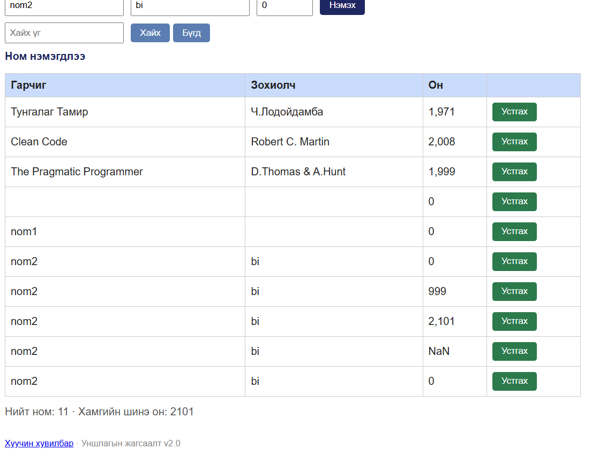

# BUG-03: Ижил гарчиг, зохиолчтой ном давхар нэмэгдэж байна

**Орчин:** Уншлагын жагсаалт v2.0, Chrome, Ubuntu WSL2, 2026-10-20

**Урьдчилсан нөхцөл:** node app.js-ийг шинээр асаасан (анхны 3 ном).

## Дахин гаргах алхам

1. node app.js командаар серверийг шинээр ажиллуулна.
2. Браузераар http://localhost:3000 хаягийг нээнэ.
3. Гарчиг талбарт nom2 гэж бичнэ.
4. Зохиолч талбарт bi гэж бичнэ.
5. Он талбарт 2020 гэж бичнэ.
6. Нэмэх товчийг дарна.
7. Ижил гарчиг, зохиолч, онтой номыг дахин нэмнэ.
8. Номын жагсаалтыг шалгана.

## Хүлээгдэж байсан үр дүн

Ижил гарчиг, зохиолчтой номыг давхардуулж
нэмэхийг систем зөвшөөрөхгүй байх ёстой.

Давхар ном нэмэх оролдлого хийхэд ойлгомжтой
алдааны мессеж харуулах ёстой.

## Бодит үр дүн

Ижил гарчиг, зохиолчтой nom2, bi номыг
олон удаа нэмэх боломжтой байв.

Систем давхардсан өгөгдлийг шалгахгүй байна.

## Ноцтой байдал

**Major** — Давхардсан ном бүртгэгдсэнээр
өгөгдлийн чанар алдагдаж, номын жагсаалтад
шаардлагагүй давхардал үүсэж байна.

## Олдсон аялал

Couch Potato Tour

## Нотолгоо

