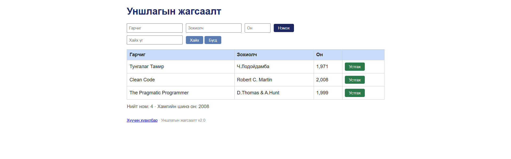

# BUG-06: Нийт номын тоолуур бодит тооноос нэгээр илүү байна

**Орчин:** Уншлагын жагсаалт v2.0, Chrome, Ubuntu WSL2, 2026-10-20

**Урьдчилсан нөхцөл:** node app.js-ийг шинээр асаасан (анхны 3 ном).

## Дахин гаргах алхам

1. Терминал дээр ажиллаж буй серверийг Ctrl+C дарж зогсооно.
2. node app.js командаар серверийг шинээр ажиллуулна.
3. Браузераар http://localhost:3000 хаягийг нээнэ.
4. Хүснэгтэд харагдаж буй номын тоог тоолно.
5. Хүснэгтийн доорх "Нийт ном" үзүүлэлтийг шалгана.

## Хүлээгдэж байсан үр дүн

Хүснэгтэд анхны 3 ном харагдаж байгаа тул
"Нийт ном: 3" гэж харуулах ёстой.

## Бодит үр дүн

Хүснэгтэд 3 ном харагдаж байгаа боловч
"Нийт ном: 4" гэж харуулж байна.

Тоолуур бодит номын тооноос нэгээр илүү байна.

## Ноцтой байдал

**Major** — Нийт номын тоог буруу харуулснаар
хэрэглэгчид өгөгдлийн талаар ташаа мэдээлэл өгч байна.

## Олдсон аялал

Couch Potato Tour

## Нотолгоо

