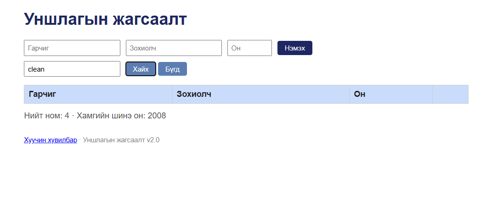
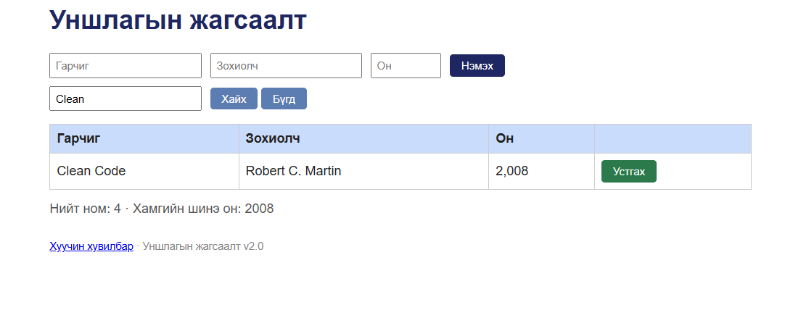

# BUG-07: Хайлтын систем том, жижиг үсэг ялгаж байна

**Орчин:** Уншлагын жагсаалт v2.0, Chrome, Ubuntu WSL2, 2026-10-20

**Урьдчилсан нөхцөл:** node app.js-ийг шинээр асаасан (анхны 3 ном).

## Дахин гаргах алхам

1. node app.js командаар серверийг шинээр ажиллуулна.
2. Браузераар http://localhost:3000 хаягийг нээнэ.
3. Хайлтын талбарт clean гэж бичнэ.
4. Хайх товчийг дарна.
5. Хайлтын үр дүнг шалгана.
6. Хайлтын талбарт CLEAN гэж бичээд дахин хайна.
7. Хайлтын талбарт Clean гэж бичээд дахин хайна.
8. Гурван хайлтын үр дүнг харьцуулна.

## Хүлээгдэж байсан үр дүн

Хайлтын систем гарчиг болон зохиолчийн нэрээр
том, жижиг үсэг ялгахгүй хайх ёстой.

clean, CLEAN, Clean гэсэн гурван хайлтаар
Clean Code ном бүгд олдох ёстой.

## Бодит үр дүн

clean гэж хайхад ном олдсонгүй.
CLEAN гэж хайхад мөн ном олдсонгүй.

Харин Clean гэж хайхад Clean Code ном
амжилттай олдсон.

Хайлтын систем том, жижиг үсэг ялгаж байна.

## Ноцтой байдал

**Major** — Хэрэглэгч номын нэрийг өөр үсгийн
хэлбэрээр хайхад байгаа номыг олж чадахгүй байна.

## Олдсон аялал

Couch Potato Tour — хайлтын оролтын хувилбаруудыг шалгах

## Нотолгоо

