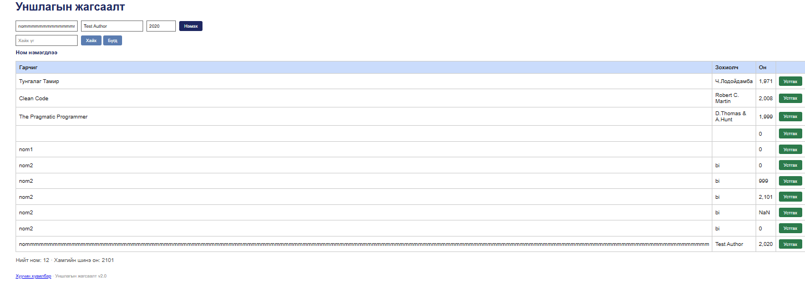

# BUG-09: Урт гарчиг оруулахад хүснэгтийн бүтэц алдагдаж байна

**Орчин:** Уншлагын жагсаалт v2.0, Chrome, Ubuntu WSL2, 2026-10-20

**Урьдчилсан нөхцөл:** node app.js-ийг шинээр асаасан (анхны 3 ном).

## Дахин гаргах алхам

1. node app.js командаар серверийг шинээр ажиллуулна.
2. Браузераар http://localhost:3000 хаягийг нээнэ.
3. Гарчиг талбарт 150-200 тэмдэгттэй урт текст оруулна.
4. Зохиолч талбарт Test Author гэж бичнэ.
5. Он талбарт 2020 гэж бичнэ.
6. Нэмэх товчийг дарна.
7. Номын жагсаалтын хүснэгтийн харагдах байдлыг шалгана.

## Хүлээгдэж байсан үр дүн

Урт гарчигтай ном нэмэгдсэн ч хүснэгтийн бүтэц эвдрэхгүй байх ёстой.

Гарчгийн текст мөр шилжих эсвэл зохих хязгаарт багтах бөгөөд бусад баганууд хэвийн харагдах ёстой.

## Бодит үр дүн

Урт гарчигтай ном нэмэгдсэн боловч хүснэгтийн гарчгийн багана хэт өргөссөн.

Зохиолч болон Он баганууд шахагдаж, зохиолчийн нэр олон мөр болж хуваагдсан.

## Ноцтой байдал

**Minor** — Өгөгдөл нэмэгдэж байгаа боловч урт текст хүснэгтийн харагдах байдлыг алдагдуулж, уншихад хүндрэл үүсгэж байна.

## Олдсон аялал

Supermodel Tour

## Нотолгоо

