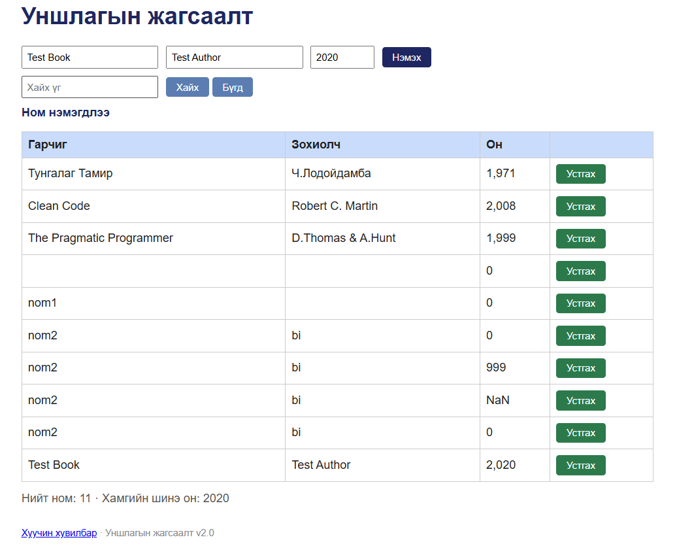

# BUG-10: Ном устгахад амжилтын мессеж шинэчлэгдэхгүй байна

**Орчин:** Уншлагын жагсаалт v2.0, Chrome, Ubuntu WSL2, 2026-10-20

**Урьдчилсан нөхцөл:** node app.js-ийг шинээр асаасан (анхны 3 ном).

## Дахин гаргах алхам

1. node app.js командаар аппыг шинээр ажиллуулна.
2. Браузераар http://localhost:3000 хаягийг нээнэ.
3. Гарчиг талбарт Test Book гэж бичнэ.
4. Зохиолч талбарт Test Author гэж бичнэ.
5. Он талбарт 2020 гэж бичнэ.
6. Нэмэх товчийг дарна.
7. "Ном нэмэгдлээ" гэсэн мессеж гарсныг шалгана.
8. Шинээр нэмсэн номын Устгах товчийг дарна.
9. Үйлдлийн дараах мессежийг шалгана.

## Хүлээгдэж байсан үр дүн

Ном амжилттай устгагдаж, тухайн үйлдэлд тохирсон
"Ном устгагдлаа" гэх мэт мэдэгдэл харагдах ёстой.

## Бодит үр дүн

Ном хүснэгтээс устсан боловч "Ном нэмэгдлээ"
гэсэн өмнөх мессеж хэвээр үлдсэн.

Устгах үйлдэл амжилттай болсон тухай
зөв мэдэгдэл хэрэглэгчид харагдаагүй.

## Ноцтой байдал

**Minor** — Ном устгах үйлдэл ажиллаж байгаа боловч
хэрэглэгчид буруу мэдээлэл харуулж байна.

## Олдсон аялал

Supermodel Tour

## Нотолгоо

